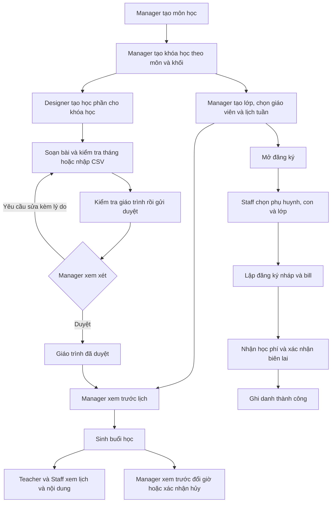

# Luồng Academic trên web

Ngày đối chiếu và kiểm thử lại: 09/10/2026. Phạm vi: Manager, Designer, Teacher và Staff trên WDP301-FE-System.

## Từ danh mục đến buổi học

Lớp và giáo trình cùng gắn với một khóa học. Hai khóa cùng môn và khối vẫn có giáo trình riêng. Có thể duyệt giáo trình trước khi tạo lớp; mở đăng ký cần lớp hoạt động và có lịch tuần, không bắt buộc đã sinh buổi.

## Các thao tác theo vai trò

1. **Manager chuẩn bị danh mục và lớp.** Vào Danh mục, tạo môn với mã/tên, rồi tạo khóa học chọn môn và khối 6–9. Vào Lớp học, tạo lớp, chọn giáo viên đang hoạt động, sức chứa và học phí tháng. Lưu lịch tuần rồi mở đăng ký khi cần.
2. **Designer chuẩn bị học phần.** Chọn đúng khóa học, đặt tên và khoảng ngày. Thêm bài có thứ tự liên tục từ 1, soạn kiểm tra tháng hoặc nhập CSV. CSV có bước xem trước và báo lỗi từng dòng; chọn thêm nội dung hoặc thay toàn bộ. Chỉ nhập bản xem trước hợp lệ; thay toàn bộ cần xác nhận.
3. **Designer gửi duyệt.** Bấm Kiểm tra giáo trình, xử lý lỗi rồi Gửi duyệt. Học phần chuyển từ Bản nháp sang Chờ duyệt và khóa soạn nội dung.
4. **Manager review.** Manager đọc nội dung. Yêu cầu sửa phải có lý do; học phần trở lại Bản nháp, Designer đọc ghi chú, sửa và gửi lại. Duyệt thành công chuyển sang Đã duyệt. Muốn thay nội dung bản đã duyệt, Designer tạo phiên bản nháp mới để duyệt lại.
5. **Manager sinh lịch.** Chọn lớp, giáo trình đã duyệt của đúng khóa và khoảng ngày. Xem trước để kiểm tra số buổi, bài học, kiểm tra tháng và xung đột. Sau khi xem trước hợp lệ, xác nhận sinh lịch. Đổi đầu vào hoặc hết hạn phải xem trước lại. Lịch sử hiển thị học phần/phiên bản và từng đợt áp dụng.
6. **Teacher và Staff đọc dữ liệu.** Teacher chỉ xem lớp được phân công, ghi danh gốc, giáo trình đã duyệt và các buổi được giao. Staff xem lịch phục vụ ghi danh. Bấm buổi học để đọc ngày/giờ, giáo viên, trạng thái và nội dung bài; hai vai trò này không có nút sinh, đổi giờ hoặc hủy buổi.
7. **Manager xử lý một buổi.** Chỉ đổi/hủy buổi chưa diễn ra và còn lên lịch. Đổi giờ nhập giờ Việt Nam và lý do, xem trước rồi xác nhận. BE kiểm tra cùng tháng/phạm vi giáo trình, thứ tự bài, trùng lịch và các ràng buộc của học viên. Hủy cần lý do và xác nhận. Lịch và chi tiết được tải lại sau khi thành công.
8. **Staff ghi danh và thu học phí.** Tra email phụ huynh, chọn con; khối lấy từ hồ sơ. Chọn lớp phù hợp, ngày bắt đầu và số tháng. Lập đăng ký nháp để xem bill; lúc này chưa có thanh toán/ghi danh thành công. Khi đã nhận đủ học phí, nhập số biên lai, xác nhận đã nhận tiền rồi xác nhận thanh toán. Kết quả: đăng ký Hoàn tất, bill Đã thanh toán, ghi danh Đang học. Reload hoặc tra cứu lại vẫn đọc được bill/biên lai.

Phụ huynh có tài khoản và hồ sơ con trên mobile; không tạo tài khoản đăng nhập riêng cho học sinh. Test tạo các điều kiện này trong DB riêng, không gửi email thật.

## Các điểm phải giữ đúng

- Học phần: Bản nháp → Chờ duyệt → Đã duyệt → Lưu trữ; yêu cầu sửa trả về Bản nháp kèm ghi chú.
- Không dùng giáo trình của khóa khác dù cùng môn/khối. Kiểm tra cấu trúc hợp lệ chưa bảo đảm đủ bài cho mọi lịch; bước xem trước sinh lịch kiểm tra tiếp số bài/kiểm tra cần dùng.
- Lịch tuần bị khóa khi có ghi danh chưa kết thúc, học viên chuyển vào chưa kết thúc hoặc bất kỳ buổi đã sinh, kể cả buổi đã hủy. Đổi giờ một buổi dùng chức năng riêng.
- Import, sinh lịch, đổi/hủy buổi và thanh toán phải dùng lại đúng dữ liệu/khóa khi retry. Reload hoặc gửi lại không được tạo bản ghi trùng.
- Mọi giờ hiển thị trên lịch và form đổi giờ là giờ Việt Nam. Teacher không đọc lớp của giáo viên khác; Staff/Designer không thực hiện lệnh thuộc quyền Manager.

## Kịch bản nghiệm thu mẫu

| Giai đoạn     | Thao tác mẫu                                                                                 | Kết quả mong đợi                                            |
| ------------- | -------------------------------------------------------------------------------------------- | ----------------------------------------------------------- |
| Lớp           | Khóa Toán khối 8; lớp 8A, giáo viên thật, học phí 800.000 đ/tháng; thứ 2/4/6 lúc 18:00–20:00 | Tạo/lưu/mở đăng ký thành công                               |
| Giáo trình    | Học phần 04–08/01/2027; hai bài và kiểm tra tháng 1; kiểm tra → gửi duyệt → duyệt            | Nội dung được duyệt cho đúng khóa                           |
| Lịch          | Xem trước rồi sinh lịch                                                                      | Ba buổi: hai bài và một kiểm tra tháng                      |
| Ghi danh      | Chọn con khối 8, ngày 04/01/2027 và gói ba tháng                                             | Bill 2.400.000 đ; lớp khối 6 không được chọn cho con khối 8 |
| Thanh toán    | Xác nhận đã nhận tiền và số biên lai                                                         | Một khoản thu, một ghi danh ACTIVE, đăng ký COMPLETED       |
| Tải lại/retry | Reload biên lai; replay sinh lịch và xác nhận thanh toán                                     | Vẫn ba buổi, một khoản thu, một ghi danh                    |
| CSV/review    | Nhập CSV UTF-8 nhiều dòng; gửi duyệt, Manager trả sửa, Designer gửi lại và Manager duyệt     | Nội dung đúng và trạng thái đúng ở từng vai trò             |
| Đổi/hủy       | Manager đổi giờ qua preview rồi hủy một buổi khác, gửi lại cùng yêu cầu                      | Revision/trạng thái cập nhật; không tạo thao tác lặp        |
| Phân quyền    | Teacher/Staff mở lịch; Teacher đọc giáo trình; Staff mở màn 390px                            | Dữ liệu thật, quyền đúng, không tràn ngang                  |

Luồng mẫu đã đạt qua trình duyệt với Nest/MySQL thật, run `mv135a3m`: ba buổi, một khoản thu 2.400.000 đ, một ghi danh ACTIVE; retry/reload không tạo trùng. CSV/review, đổi-hủy buổi, nội dung Teacher/Staff và màn 390px cũng đạt. Có [12 ảnh/evidence của luồng desktop thật](screenshots/academic-desktop-real-2026-10-09/evidence.json).

Kết quả chạy lại được cập nhật tại [ACADEMIC_API_INTEGRATION.md](ACADEMIC_API_INTEGRATION.md). Bài test BE và luồng trình duyệt thật dùng MySQL riêng; DB ứng dụng local vẫn cần migration Academic theo hướng dẫn trong tài liệu tích hợp.
