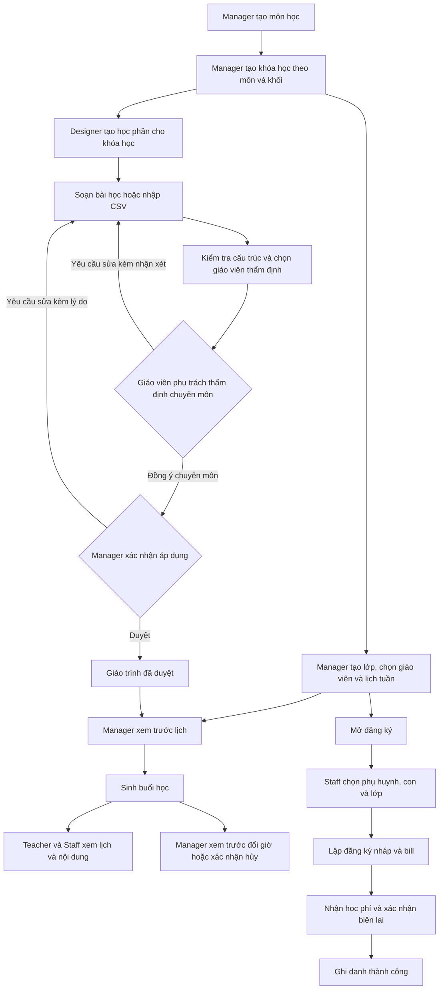

# Luồng Academic trên web

Ngày cập nhật: 14/10/2026. Phạm vi: Manager, Designer, Teacher và Staff trên WDP301-FE-System.

Thay đổi nghiệp vụ: giữ kiểm tra cấu trúc giáo trình; giáo viên phụ trách khóa học thẩm định chuyên môn trước khi Quản lý xác nhận áp dụng. Bài kiểm tra được tạo riêng trong luồng bài tập của giáo viên, chọn buổi và loại 15 phút/một tiết/giữa kỳ/học kỳ. Lịch mới không tự chèn kiểm tra vào cuối tháng. Lịch và nội dung đã dùng giữ nguyên; chỉnh giáo trình bằng nháp cho kỳ tiếp theo.

## Từ danh mục đến buổi học

Lớp và giáo trình cùng gắn với một khóa học. Hai khóa cùng môn và khối vẫn có giáo trình riêng. Có thể soạn giáo trình trước khi tạo lớp; gửi thẩm định cần giáo viên đang phụ trách một lớp của cùng khóa học. Mở đăng ký cần lớp hoạt động và có lịch tuần, không bắt buộc đã sinh buổi.

## Bố cục và thao tác trên web

- Dashboard Quản lý theo mẫu cam/kem có sáu KPI (ba thẻ/hàng), biểu đồ doanh thu/buổi hoàn thành sáu tháng, phân bố hồ sơ học sinh theo khối, hoạt động gần đây/thống kê hoạt động và lịch nhanh. Chọn kỳ bằng nút khoảng ngày ở đầu trang; học phí và export Excel theo kỳ, biểu đồ tháng lấy sáu tháng kết thúc tại kỳ đó. Số hồ sơ/tài khoản/lớp là số hiện tại. Phân bố dùng khối thật của hồ sơ hoạt động; thống kê hoạt động ghi rõ nếu chỉ lấy 100 sự kiện mới nhất. Dashboard Giáo viên cùng tông màu, hiển thị lớp được giao, lịch hôm nay, bài nộp và việc chấm/duyệt/công bố. Theme không đổi màu các màn hình còn lại.
- Danh sách tài khoản, lời mời, danh mục và thanh toán dùng bảng có bộ lọc/phân trang; bảng cuộn trong vùng riêng khi màn hình hẹp. Lớp và giáo trình dùng card gọn, tối đa bốn card trên màn rộng. Biểu mẫu tạo và danh sách nằm cạnh nhau khi đủ chiều rộng, xếp dọc trên mobile.
- Lịch học có ba cách xem **Ngày / Tuần / Kanban**. Kanban chia theo bảy ngày, sắp buổi theo giờ và hiển thị trạng thái thật. Dùng Tuần trước/Tuần sau/Hôm nay, lọc lớp rồi chọn card để mở chi tiết. Manager vẫn đổi/hủy buổi qua luồng xác nhận hiện có; Teacher/Staff xem lịch. Không kéo thả card để đổi lịch.
- Menu chỉ đánh dấu một mục khớp đường dẫn sâu nhất; Designer chỉ có một lối vào giáo trình. Ô tìm kiếm hoặc Ctrl/⌘ K mở các màn hình/tác vụ thuộc quyền của vai trò hiện tại, hỗ trợ tìm không dấu. Chuông của Manager/Teacher đọc năm thông báo lớp mới nhất; không hiển thị số chưa đọc giả.

## Các thao tác theo vai trò

1. **Manager chuẩn bị danh mục và lớp.** Vào Danh mục, tạo môn với mã/tên, rồi tạo khóa học chọn môn và khối 6–9. Vào Lớp học, tạo lớp, chọn giáo viên đang hoạt động, sức chứa và học phí tháng. Lưu lịch tuần rồi mở đăng ký khi cần.
2. **Designer chuẩn bị giáo trình.** Chọn đúng khóa học, tên và khoảng ngày; thêm bài liên tục từ 1 hoặc nhập CSV bài học. File có bước xem trước và lỗi từng dòng; thay toàn bộ bài cần xác nhận. Không soạn/import kiểm tra tháng trong giáo trình.
3. **Designer gửi thẩm định.** Giữ nút Kiểm tra giáo trình để kiểm tra cấu trúc, sau đó chọn giáo viên đang phụ trách lớp thuộc cùng khóa học. Gửi thành công chuyển sang Chờ thẩm định chuyên môn và khóa nội dung nháp.
4. **Giáo viên và Manager duyệt theo thứ tự.** Giáo viên được chỉ định đọc từng bài tại `/teacher/curriculum`, đồng ý chuyên môn hoặc trả lại nháp với nhận xét bắt buộc. Chỉ sau khi giáo viên đồng ý, Manager được Xác nhận áp dụng. Manager trả lại nháp sẽ hủy kết quả thẩm định cũ. Bản đã duyệt giữ nguyên; Chuẩn bị cho kỳ tiếp theo yêu cầu ngày bắt đầu sau kỳ gốc và sau hôm nay, rồi thực hiện lại đầy đủ quy trình duyệt.
5. **Manager sinh lịch.** Chọn lớp, giáo trình được xác nhận của đúng khóa và khoảng ngày. Mỗi buổi mới dùng một bài học thường, kể cả buổi cuối tháng. Xem trước số bài và xung đột rồi sinh lịch; đổi đầu vào/hết hạn phải xem trước lại. Lịch sử dùng tên giáo trình và khoảng áp dụng thay nhãn phiên bản kỹ thuật.
6. **Teacher và Staff đọc dữ liệu.** Teacher xem lớp/buổi được giao, giáo trình đã duyệt và bản chờ thẩm định được chỉ định. Staff xem lịch phục vụ ghi danh. Hai vai trò không có nút sinh/đổi giờ/hủy buổi. Kiểm tra mới do Teacher tạo tại Bài tập / Đề kiểm tra, chọn đúng buổi chưa kết thúc được giao và loại kiểm tra; không thay lessonId của buổi.
7. **Manager xử lý một buổi.** Chỉ đổi/hủy buổi chưa diễn ra và còn lên lịch. Đổi giờ nhập giờ Việt Nam và lý do, xem trước rồi xác nhận. BE kiểm tra cùng tháng/phạm vi giáo trình, thứ tự bài, trùng lịch và các ràng buộc của học viên. Hủy cần lý do và xác nhận. Lịch và chi tiết được tải lại sau khi thành công.
8. **Staff ghi danh và thu học phí.** Tra email phụ huynh, chọn con; khối lấy từ hồ sơ. Chọn lớp phù hợp, ngày bắt đầu và số tháng. Lập đăng ký nháp để xem bill; lúc này chưa có thanh toán/ghi danh thành công. Khi đã nhận đủ học phí, nhập số biên lai, xác nhận đã nhận tiền rồi xác nhận thanh toán. Kết quả: đăng ký Hoàn tất, bill Đã thanh toán, ghi danh Đang học. Reload hoặc tra cứu lại vẫn đọc được bill/biên lai.

Phụ huynh có tài khoản và hồ sơ con trên mobile; không tạo tài khoản đăng nhập riêng cho học sinh. Test tạo các điều kiện này trong DB riêng, không gửi email thật.

## Các điểm phải giữ đúng

- Học phần: Bản nháp → Chờ duyệt → Đã duyệt → Lưu trữ; yêu cầu sửa trả về Bản nháp kèm ghi chú.
- Không dùng giáo trình của khóa khác dù cùng môn/khối. Kiểm tra cấu trúc hợp lệ chưa bảo đảm đủ bài cho mọi lịch; bước xem trước sinh lịch kiểm tra đủ bài học thường cho từng buổi.
- Lịch tuần bị khóa khi có ghi danh chưa kết thúc, học viên chuyển vào chưa kết thúc hoặc bất kỳ buổi đã sinh, kể cả buổi đã hủy. Đổi giờ một buổi dùng chức năng riêng.
- Import, sinh lịch, đổi/hủy buổi và thanh toán phải dùng lại đúng dữ liệu/khóa khi retry. Reload hoặc gửi lại không được tạo bản ghi trùng.
- Mọi giờ hiển thị trên lịch và form đổi giờ là giờ Việt Nam. Teacher không đọc lớp của giáo viên khác; Staff/Designer không thực hiện lệnh thuộc quyền Manager.

## Kịch bản nghiệm thu mẫu

| Giai đoạn     | Thao tác mẫu                                                                                  | Kết quả mong đợi                                            |
| ------------- | --------------------------------------------------------------------------------------------- | ----------------------------------------------------------- |
| Lớp           | Khóa Toán khối 8; lớp 8A, giáo viên thật, học phí 800.000 đ/tháng; thứ 2/4/6 lúc 18:00–20:00  | Tạo/lưu/mở đăng ký thành công                               |
| Giáo trình    | Học phần 04–08/01/2027; ba bài học; kiểm tra cấu trúc → chọn giáo viên → thẩm định → xác nhận | Nội dung được duyệt theo hai cấp cho đúng khóa              |
| Lịch          | Xem trước rồi sinh lịch                                                                       | Ba buổi dùng ba bài học thường, không tự chèn kiểm tra      |
| Ghi danh      | Chọn con khối 8, ngày 04/01/2027 và gói ba tháng                                              | Bill 2.400.000 đ; lớp khối 6 không được chọn cho con khối 8 |
| Thanh toán    | Xác nhận đã nhận tiền và số biên lai                                                          | Một khoản thu, một ghi danh ACTIVE, đăng ký COMPLETED       |
| Tải lại/retry | Reload biên lai; replay sinh lịch và xác nhận thanh toán                                      | Vẫn ba buổi, một khoản thu, một ghi danh                    |
| CSV/review    | Nhập CSV UTF-8 nhiều dòng; gửi duyệt, Manager trả sửa, Designer gửi lại và Manager duyệt      | Nội dung đúng và trạng thái đúng ở từng vai trò             |
| Đổi/hủy       | Manager đổi giờ qua preview rồi hủy một buổi khác, gửi lại cùng yêu cầu                       | Revision/trạng thái cập nhật; không tạo thao tác lặp        |
| Phân quyền    | Teacher/Staff mở lịch; Teacher đọc giáo trình; Staff mở màn 390px                             | Dữ liệu thật, quyền đúng, không tràn ngang                  |

Luồng mẫu đã đạt qua trình duyệt với Nest/MySQL thật, run `mv135a3m`: ba buổi, một khoản thu 2.400.000 đ, một ghi danh ACTIVE; retry/reload không tạo trùng. CSV/review, đổi-hủy buổi, nội dung Teacher/Staff và màn 390px cũng đạt. Có [12 ảnh/evidence của luồng desktop thật](screenshots/academic-desktop-real-2026-10-09/evidence.json).

Kết quả chạy lại được cập nhật tại [ACADEMIC_API_INTEGRATION.md](ACADEMIC_API_INTEGRATION.md). Bài test BE và luồng trình duyệt thật dùng MySQL riêng; DB ứng dụng local vẫn cần migration Academic theo hướng dẫn trong tài liệu tích hợp.
