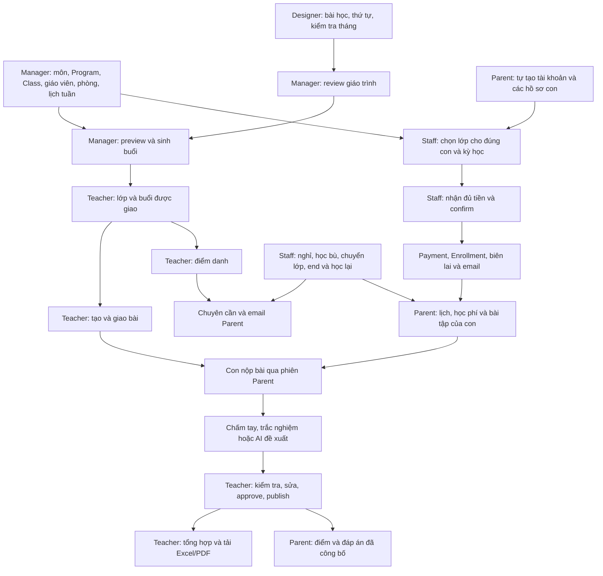

# Đối chiếu API theo 5 vai trò và luồng nghiệp vụ SRS

Ngày kiểm tra: **10/10/2026**. Phạm vi chính: **Web WDP301-FE-System**; đọc thêm Mobile để kiểm tra luồng liên thông với phụ huynh.

**Mốc trước triển khai:** các bảng dưới đây đối chiếu commit được ghi bên dưới. Các nhóm “Có BE, chưa nối” của Web đã được tích hợp trong lượt tiếp theo; trạng thái và luồng mới xem [WEB_EXISTING_API_INTEGRATION.md](WEB_EXISTING_API_INTEGRATION.md). Mobile không nằm trong phạm vi sửa code.

| Repo    | Commit được đối chiếu |
| ------- | --------------------- |
| Web     | `6f659fb`             |
| Backend | `c29d57c`             |
| Mobile  | `633296f`             |

Đây là kiểm tra tĩnh controller, DTO, service, Prisma, BFF và màn hình đang được route sử dụng. Không phải kết quả chạy lại toàn bộ API hay nghiệm thu toàn bộ SRS. Kiểm thử Academic đã thực hiện trước đó được ghi riêng trong [ACADEMIC_API_INTEGRATION.md](ACADEMIC_API_INTEGRATION.md) và [ACADEMIC_USER_FLOW.md](ACADEMIC_USER_FLOW.md).

## 1. Căn cứ và cách đọc

**Yêu cầu nghiệp vụ:** [SRS ngày 03/10](../SRS.md), nhất là §3, §5, §6 và §8. Đọc cùng [BUSINESS_WORKFLOW.md](BUSINESS_WORKFLOW.md), [CLAUDE.md](../CLAUDE.md), [AGENTS.md](../AGENTS.md), rules bảo mật và memory của Web; [AGENT.MD của BE](../../WDP301-BE-System/AGENT.MD).

**Contract hiện tại:** [ACADEMIC_API_FLOW.md](../../WDP301-BE-System/ACADEMIC_API_FLOW.md), [CURRICULUM_SCHEDULING_API.md](../../WDP301-BE-System/CURRICULUM_SCHEDULING_API.md), [PAYMENT_BILL_API.md](../../WDP301-BE-System/PAYMENT_BILL_API.md), [EDUGRADE_BACKEND_FLOW.md](../../WDP301-BE-System/EDUGRADE_BACKEND_FLOW.md), cùng source được dẫn dưới từng vai trò.

[BACKEND_API_REQUIREMENTS_WEB_MOBILE.md](BACKEND_API_REQUIREMENTS_WEB_MOBILE.md) là backlog đối chiếu **07/10**, còn các `BE_FIX_REQUESTS.md` là ghi chú lịch sử. Nhiều mục đã được xử lý sau đó. Khi xác định API tồn tại, dùng controller/service hiện tại; khi đánh giá đúng nghiệp vụ, dùng SRS và quyết định đã ghi nhận. Không lấy ghi chú cũ “chưa có API” làm kết luận tự động.

Mọi URL bên dưới tương đối với **`/api/v1`**. URL ghi **đề xuất** chưa phải contract BE đang có.

| Trạng thái                           | Ý nghĩa                                                                                                   |
| ------------------------------------ | --------------------------------------------------------------------------------------------------------- |
| **Đã nối**                           | Màn hình đang dùng gọi API thật qua client/BFF. Chưa đồng nghĩa môi trường deploy đã có migration/config. |
| **Có BE, chưa nối**                  | Route BE tồn tại; Web/Mobile còn mock hoặc chưa gọi. Ưu tiên tích hợp, không tạo lại API.                 |
| **Thiếu BE**                         | Chưa tìm thấy route/command cho nghiệp vụ trong controller hiện tại.                                      |
| **Cần sửa BE**                       | Route đã có nhưng quyền, dữ liệu hoặc hành vi chưa đáp ứng đủ SRS.                                        |
| **Đề xuất ngoài yêu cầu rõ của SRS** | Có trong UI/backlog hoặc là tiện ích; không tính như chức năng SRS bắt buộc bị thiếu.                     |

**P0**: đứt luồng hoặc sai quyền/dữ liệu. **P1**: hoàn thiện chức năng SRS. **P2**: tiện ích hoặc phạm vi cần chốt.

## 2. Tổng quan theo vai trò

| Vai trò         | Đã nối đáng chú ý                                                                                                           | Khoảng trống chính                                                                                                                                                                |
| --------------- | --------------------------------------------------------------------------------------------------------------------------- | --------------------------------------------------------------------------------------------------------------------------------------------------------------------------------- |
| Manager — Web   | Subject/Program, Class/lịch tuần, giáo viên cho selector lớp, review giáo trình, sinh/đổi/hủy buổi, danh sách phụ huynh/con | Mời/duyệt giáo viên; quản lý thêm Manager; phòng; dạy thay; đổi giáo viên khi đã có lịch và lưu lịch sử. Directory CRUD/dashboard có BE nhưng Web chưa nối đầy đủ.                |
| Designer — Web  | Học phần, bài học/thứ tự, kiểm tra tháng, CSV, validation/submit, sửa theo review, revision/archive                         | Luồng nội dung chính đã nối. Feedback giáo trình có BE nhưng chưa nối; AI soạn giáo trình là đề xuất, không phải yêu cầu AI chấm bài của SRS.                                     |
| Staff — Web     | Tra email/chọn con, lập đăng ký, bill, nhận đủ tiền/confirm, biên lai/in, đọc lớp/lịch                                      | Nghỉ/học bù/chuyển lớp/end đã có BE nhưng màn Web vẫn mock và chưa có route Staff tương ứng. Thiếu cho học lại hồ sơ INACTIVE; đơn nghỉ một buổi phụ thuộc roster được tạo trước. |
| Teacher — Web   | Lớp được phân công, chi tiết lớp, giáo trình, lịch và chi tiết buổi                                                         | Attendance, assignment, grading/AI/report vẫn mock dù BE đã có. Thiếu API chuyên cần dùng chung và xác nhận lịch theo cách hiểu “set cứng” đang chờ chốt.                         |
| Parent — Mobile | Auth/xác minh email, con, enrollment/bill/receipt, lịch thường, đơn bảo lưu, bài tập/nộp bài/điểm đã công bố                | Thiếu chuyên cần thật; lịch chưa đủ học bù/lịch sử theo con. Chi tiết buổi có BE mới nhưng Mobile chưa nối. Điểm/tiến độ có một phần dữ liệu nhưng chưa đủ tổng hợp.              |

Các nhóm này có giao nhau: ví dụ chuyên cần và email ảnh hưởng nhiều vai trò. Không cộng số dòng thành “tổng số API còn thiếu”.

## 3. Manager — Quản lý trung tâm

Căn cứ SRS §3.1, §5.4, §5.14, §6.2, §8.

| Nghiệp vụ                                    | API/hành vi hiện tại                                                                                                             | Kết luận và việc còn lại                                                                                                                                                                                                                                                                                                                          |
| -------------------------------------------- | -------------------------------------------------------------------------------------------------------------------------------- | ------------------------------------------------------------------------------------------------------------------------------------------------------------------------------------------------------------------------------------------------------------------------------------------------------------------------------------------------- |
| Danh sách/chi tiết/tạo/sửa/khóa giáo viên    | `GET/POST /teachers`, `GET/PATCH /teachers/:id`. Tạo trực tiếp bằng email/name/password, trạng thái ACTIVE; sửa name/status.     | **Có BE, chưa nối — P1.** Màn quản lý giáo viên dùng mock. Riêng selector gán giáo viên trong màn Class đã gọi `GET /teachers` thật. BFF mới cho GET teacher, chưa mở POST/PATCH. Khóa dùng status, không cần tạo API hard-delete chỉ để đủ chữ CRUD.                                                                                             |
| Quản lý nhân viên                            | `GET/POST /staff`, `GET/PATCH /staff/:id`                                                                                        | **Có BE, chưa nối — P1.** Hook tài khoản nhân sự vẫn mock; BFF chưa mở các method này.                                                                                                                                                                                                                                                            |
| Quản lý phụ huynh                            | `GET /parents`, `GET /parents/:id`, `PATCH /parents/:id`                                                                         | **Đã nối list; detail/update chưa nối — P1.** BFF chưa cho detail/PATCH. Manager sửa contact/status; phụ huynh tự đăng ký tài khoản và tạo con theo SRS §5.2–5.3. Không yêu cầu Manager tạo hộ mật khẩu/tài khoản phụ huynh.                                                                                                                      |
| Mời và duyệt giáo viên                       | POST teacher hiện là tạo tài khoản trực tiếp, không có trạng thái invitation/review                                              | **Thiếu BE — P1.** SRS §3.1 yêu cầu mời/duyệt. Đề xuất nhóm `POST/GET /teacher-invitations`, review/accept/resend với token có hạn và lịch sử. Phải chốt ai nhận/duyệt lời mời; direct-create hiện tại không thay thế toàn bộ quy trình này. Model `LinkInvitation` cũ thuộc registration không chứng minh đã có teacher invitation.              |
| Mời Manager khác, danh sách và phân quyền    | Directory chỉ quản lý target STAFF/TEACHER; không thấy route Manager account/invitation/permission                               | **Thiếu BE và thiếu khả năng ở Web — P1.** Đề xuất nhóm `/managers`, `/manager-invitations`. Web hiện chỉ cho `center_manager` quản lý target `staff`; không cho mời Manager. SRS nói “phân quyền” nhưng cấu trúc permission cụ thể cần chốt vì Web hiện áp quyền theo role, không có quyền con. SRS có 5 role; không tự thêm role ADMIN thứ sáu. |
| Tạo lớp có phòng                             | Class và ClassSession có teacherId nhưng không có roomId/Room                                                                    | **Thiếu BE — P1.** Đề xuất `GET/POST /rooms`, `PATCH /rooms/:id`; gắn roomId vào class/session và dữ liệu lịch, kiểm tra sức chứa/trùng phòng. SRS §3.1 và model §7 có phòng.                                                                                                                                                                     |
| Gán/đổi giáo viên lớp                        | `POST /classes`, `PATCH /classes/:id` có teacherId                                                                               | **Đã nối nhưng cần bổ sung BE — P1.** PATCH chặn đổi nếu còn buổi SCHEDULED trong tương lai (`CLASS_TEACHER_LOCKED`). Chưa thấy luồng đổi từ ngày hiệu lực, tác động các buổi tương lai, giữ giáo viên buổi cũ và lịch sử theo §5.14. Không kết luận “BE chưa có teacher assignment”; phần thiếu là đổi lớp đang vận hành.                        |
| Xếp giáo viên dạy thay                       | Có teacherId trên session và API tạo session thủ công; không có command thay giáo viên trên buổi hiện hữu                        | **Thiếu BE — P1.** Đề xuất `GET /academic/sessions/:id/substitute-candidates`, `POST /academic/sessions/:id/substitutions`. Giữ cùng buổi/bài/học viên, kiểm tra trùng lịch, lưu người gán/lý do/lịch sử. Teacher không tự nhận lớp. Báo nghỉ giáo viên bằng app là phần mở rộng, không phải điều kiện duy nhất để Manager xếp dạy thay.          |
| Danh mục, lớp, lịch, duyệt/sinh/đổi/hủy buổi | Subject/Program CRUD; Class/lịch tuần; unit approve/request-changes; session preview/generate/history/detail/reschedule/cancel   | **Đã nối.** Không yêu cầu tạo lại các API này. Còn sai dữ liệu danh sách lớp sau chuyển lớp: `GET /classes/:id` lấy enrollments theo classId gốc, chưa trả đúng roster hiện tại theo placement.                                                                                                                                                   |
| Dashboard doanh thu và số lượng              | `GET /dashboard` có tổng tiền đã confirm và counts, Manager-only                                                                 | **Có BE, chưa nối — P1.** Màn Manager hiện chỉ lấy list classes để đếm lớp, chưa gọi dashboard. BFF chưa mở route này. Không cần dựng BE dashboard mới.                                                                                                                                                                                           |
| Thông báo email nghỉ lễ/quan trọng           | `POST/GET /academic/announcements`, `POST /academic/announcements/:id/send-email`; `POST /academic/tuition-reminders/send-email` | **Có BE, chưa nối; cần bổ sung độ tin cậy email — P1.** Gửi hiện đồng bộ, trả `automaticRetry:false`; xem phần 8. Không có hộp thông báo trong app là thiếu bắt buộc của SRS.                                                                                                                                                                     |

**Luồng nghiệp vụ Manager:** đăng nhập → quản lý/mời nhân sự → tạo môn và Program → tạo Class, chọn giáo viên/phòng/sức chứa/học phí → lưu lịch tuần và mở đăng ký → review học phần Designer gửi → yêu cầu sửa hoặc approve → preview sinh buổi → generate → xem lịch → xử lý đổi giờ/hủy/dạy thay hoặc đổi giáo viên có hiệu lực → xem doanh thu/counts. Hiện các bước phòng, invitation, dạy thay và đổi giáo viên lớp đang có buổi chưa hoàn chỉnh; dashboard/CRUD nhân sự cần nối API sẵn có.

Nguồn: [Directory controller/service][be-directory], [Class/registration service][be-registration], [schema][be-schema], [hook giáo viên][fe-teachers], [hook nhân sự][fe-staff], [dashboard đang dùng][fe-dashboard], [role access][fe-role], [BFF whitelist][fe-bff].

## 4. Designer — Thiết kế giáo trình

Căn cứ SRS §3.2, §5.4, §6.2, §8; contract bổ sung ở ACADEMIC_API_FLOW.

| Nghiệp vụ                                      | API hiện tại                                                                                                                                               | Kết luận                                                                                                                                                              |
| ---------------------------------------------- | ---------------------------------------------------------------------------------------------------------------------------------------------------------- | --------------------------------------------------------------------------------------------------------------------------------------------------------------------- |
| Đọc khóa, tạo/sửa học phần theo đúng Program   | `GET /programs`, `GET /programs/:id`; `GET/POST /academic/curriculum-units`, `GET/PATCH /academic/curriculum-units/:id`                                    | **Đã nối.** Designer viết nội dung, không tạo Class hay thay lịch.                                                                                                    |
| Bài theo thứ tự, một bài/buổi                  | `POST /academic/curriculum-units/:id/lessons`; `PATCH/DELETE .../:id/lessons/:lessonId`; `PUT .../:id/lesson-order`                                        | **Đã nối.** Không còn là API thiếu như backlog cũ.                                                                                                                    |
| Một kiểm tra/tháng                             | `POST /academic/curriculum-units/:id/monthly-tests`, validation và kiểm tra preview sinh lịch                                                              | **Đã nối.** Cần giữ validation cấu trúc và preview số bài/kiểm tra cần dùng trong khoảng lịch.                                                                        |
| Nhập CSV, kiểm tra rồi gửi duyệt               | `POST .../:id/import-preview`, `.../import-commit`, `.../validation`, `.../submit`                                                                         | **Đã nối.** Có lỗi từng dòng, preview/commit và retry giữ body/key.                                                                                                   |
| Sửa theo review, phiên bản mới, archive        | Manager `POST .../:id/request-changes`; Designer PATCH rồi submit; `POST .../:id/revisions`, `DELETE /academic/curriculum-units/:id` theo trạng thái/quyền | **Đã nối.** DRAFT → SUBMITTED → APPROVED; request-changes đưa về DRAFT; sửa bản đã approve qua revision.                                                              |
| Feedback bài học từ Teacher                    | `GET /academic/feedback`, `POST /academic/feedback/:id/resolve`; Teacher `POST /academic/lessons/:id/feedback`                                             | **Có BE, chưa nối — P2 theo backlog/docs.** Không phải khoảng thiếu endpoint chính của SRS §3.2.                                                                      |
| AI gợi ý/soạn giáo trình, bộ sách/metadata SGK | Không thấy API AI curriculum draft riêng; content hiện cho phép Designer soạn theo SGK                                                                     | **Đề xuất ngoài yêu cầu rõ của SRS — P2.** AI trong SRS là chấm bài/tổng hợp báo cáo. Không đưa AI soạn giáo trình vào danh sách bắt buộc chỉ vì có trong đề xuất UI. |

**Luồng nghiệp vụ Designer:** đăng nhập → chọn đúng Program/môn/khối → tạo học phần và khoảng ngày → soạn bài theo thứ tự, kiểm tra tháng hoặc CSV → validation → sửa lỗi → submit → Manager yêu cầu sửa thì đọc lý do/sửa/submit lại → approve thì dùng phiên bản đó để sinh lịch → khi cần sửa nội dung đã duyệt, tạo revision và duyệt lại. Không cần cấp Designer API cấu hình lớp/phòng/lịch.

**Kết luận:** chưa phát hiện nhóm API nội dung cốt lõi của Designer còn thiếu sau đợt Academic mới. Đây là đánh giá source, không phải xác nhận toàn bộ nội dung đã đạt SGK hay mọi ca dữ liệu đã nghiệm thu. Legacy `POST /academic/lessons` vẫn cho Manager tạo nội dung; cần siết lại quyền theo SRS, xem phần 8.

Nguồn: [Curriculum controller][be-curriculum-controller], [Curriculum service][be-curriculum], [Web curriculum client][fe-curriculum], [Academic user flow](ACADEMIC_USER_FLOW.md).

## 5. Staff — Nhân viên

Căn cứ SRS §3.3, §3.6, §3.8, §5.6–5.10, §6.1 và §6.4–6.8.

| Nghiệp vụ                                            | API/hành vi hiện tại                                                                                                                                                           | Kết luận và việc còn lại                                                                                                                                                                                                                                                                                                                                                                                                                                                                                   |
| ---------------------------------------------------- | ------------------------------------------------------------------------------------------------------------------------------------------------------------------------------ | ---------------------------------------------------------------------------------------------------------------------------------------------------------------------------------------------------------------------------------------------------------------------------------------------------------------------------------------------------------------------------------------------------------------------------------------------------------------------------------------------------------- |
| Tra email → chọn con → đăng ký → thu tiền → biên lai | `GET /parents/search`, `/parents/lookup`, `/classes`; `POST /registrations`; `GET /registrations/:id`, `.../bill`; `POST .../confirm-payment`, `.../cancel`; `GET .../receipt` | **Đã nối.** Staff nhận đủ tiền rồi confirm; Payment/Enrollment/biên lai được tạo, enrollment gắn con ngay. Email tự động sau confirm còn thiếu.                                                                                                                                                                                                                                                                                                                                                            |
| Danh sách đăng ký/khoản thu toàn trung tâm           | `GET /registrations`, `GET /payments` có search/filter/pagination                                                                                                              | **Có BE, chưa nối — P1.** Màn Payments hiện lấy ID đã nhớ trên thiết bị rồi gọi từng registration. BFF chưa allow hai route list; đổi máy có thể không thấy toàn bộ lịch sử dù dữ liệu BE vẫn tồn tại.                                                                                                                                                                                                                                                                                                     |
| Chọn enrollment của con để vận hành                  | `GET /students/:id/enrollments`, `GET /students/:id/schedule`; list `/students`                                                                                                | **List đã nối, enrollment/schedule detail chưa nối đầy đủ — P1.** BFF chưa mở hai route detail này. Không tạo lại API.                                                                                                                                                                                                                                                                                                                                                                                     |
| Nghỉ một buổi                                        | `POST/GET /academic/leaves`; `POST .../:id/decide`, `.../cancel`. Staff tạo đơn được auto-approve.                                                                             | **Có BE, chưa nối; cần sửa BE — P0.** SINGLE_ABSENCE yêu cầu SessionParticipant đã tồn tại. Generate/confirm-payment chưa tạo participant; prepare-roster hiện qua API Teacher/Manager. Staff có thể bị kẹt khi phụ huynh báo nghỉ trước buổi học. Cần bảo đảm participant hợp lệ trong service nghiệp vụ; không cấp Staff quyền chốt attendance toàn lớp để xử lý workaround. Approval nghỉ một buổi hiện không trực tiếp đổi attendance thành ABSENT; cần chốt cách thể hiện trước khi Teacher finalize. |
| Tìm và xếp học bù/đổi một buổi                       | `GET /academic/makeup-sources?studentId=`, `GET /academic/participants/:id/makeup-candidates`; `POST/GET /academic/makeups`, `POST .../:id/cancel`                             | **Có BE, chưa nối — P0/P1.** Màn absences vẫn mock. API booking đã kiểm tra cùng lesson, buổi tương lai, kỳ học, nghỉ/trùng/chỗ; tính chỗ bằng regular reservations và makeup. Phần cần bổ sung là candidates: hiện đếm participants, chưa trả eligibility/availableSeats hoặc lọc chỉ buổi còn chỗ. Dùng cùng cách tính với booking để roster chưa tạo không làm gợi ý chỗ trống sai.                                                                                                                     |
| Đổi cố định sang lớp khác                            | `POST /academic/enrollments/:id/transfer` có effectiveAt/reason và placement history                                                                                           | **Có BE, chưa nối — P1.** BE yêu cầu cùng Program và cùng monthlyFee; SRS chỉ ghi cùng Program/lịch khác/còn chỗ. Quy tắc học phí là ràng buộc thêm cần chốt. Khi đọc lớp hiện tại phải dùng placement, không classId gốc.                                                                                                                                                                                                                                                                                 |
| Tạm nghỉ dài hạn                                     | `POST/GET /academic/leaves` kind PERIOD_PAUSE, approve/cancel; prepareRoster xét leave APPROVED để tạo EXCUSED                                                                 | **Có BE, chưa nối — P1.** Khoảng ngày xác định trạng thái tạm nghỉ; hết khoảng tiếp tục học. Không mặc định phải thêm endpoint resume khi bảo lưu tự hết hạn.                                                                                                                                                                                                                                                                                                                                              |
| Nghỉ một môn/nghỉ hẳn                                | `POST /academic/enrollments/:id/end`, `POST /academic/students/:id/end-study`                                                                                                  | **Có BE, chưa nối — P1.** Có impact/history; end-study đặt con INACTIVE. Controller hiện kết thúc ngay, không dùng body ngày hiệu lực/lý do như một số UI mock. Ngày hiệu lực tùy chọn là mở rộng; email theo SRS vẫn thiếu.                                                                                                                                                                                                                                                                               |
| Cho học lại sau nghỉ hẳn                             | Không có command reactivate; đăng ký chặn `STUDENT_INACTIVE`; parent PATCH con không nhận status                                                                               | **Thiếu BE — P0.** Đề xuất `POST /students/:id/reactivate` cho Staff, có reason/history → đăng ký và thu tiền tạo Enrollment mới. Giữ đúng StudentProfile cũ theo §5.9, không tạo con khác để né INACTIVE.                                                                                                                                                                                                                                                                                                 |
| Đổi booking học bù/kết thúc bảo lưu sớm              | Có cancel makeup và cancel leave, chưa có atomic reschedule/end-early                                                                                                          | **Đề xuất bổ sung — P1/P2 theo UI, không phải endpoint mới được SRS gọi tên.** Nếu giữ các nút hiện tại, đề xuất `POST /academic/makeups/:id/reschedule`, `POST /academic/leaves/:id/end-early`. Cancel toàn bộ đơn không tương đương kết thúc phần còn lại khi quá khứ đã EXCUSED; tránh cancel+create mất booking nếu bước sau lỗi.                                                                                                                                                                      |

**Lỗi route Web cần xử lý:** màn nghỉ/học bù/chuyển lớp nằm ở `/manager/absences/*`; Staff bị chặn vào `/manager/*`, còn Manager không có AREA.ABSENCES. Source hiện chưa có `/staff/absences/*`; BFF cũng chưa allow nhóm academic workflow. Vì vậy đây vừa là việc nối API vừa là việc đưa màn về đúng role. Không kết luận tất cả API nghỉ/học bù đều thiếu BE.

**Luồng Staff — đăng ký/thu tiền:** phụ huynh tự tạo tài khoản/con → Staff gõ email có debounce → chọn đúng parent/con → lọc lớp theo khối, kỳ học và lịch → chọn số tháng 1–12 → POST registration DRAFT → đọc bill → nhận đủ tiền → confirm với key chống lặp → COMPLETED + một Payment + một Enrollment ACTIVE → xem/in receipt → hệ thống gửi email. Staff không tạo hộ tài khoản, không dùng link kích hoạt enrollment.

**Luồng Staff — nghỉ/học bù:** chọn con/enrollment/buổi → ghi SINGLE_ABSENCE → đơn approved → đọc source participant → tìm buổi cùng Program/bài, tương lai và còn chỗ → book makeup → Teacher điểm danh buổi thay thế → đi bù thì buổi gốc được thể hiện MADE_UP, không đi thì ABSENT → cập nhật chuyên cần/email. Đổi một buổi dùng cùng quy trình, không sửa lịch tuần cả lớp.

**Luồng Staff — chuyển lớp/nghỉ/học lại:** chọn enrollment → chuyển lớp cùng Program từ effectiveAt, giữ placement cũ → hoặc tạo PERIOD_PAUSE với ngày đầu/cuối, các buổi trong khoảng EXCUSED, hết khoảng học tiếp → hoặc end một enrollment/end-study toàn bộ enrollment của riêng con → muốn học lại sau end-study: reactivate hồ sơ cũ **(đang thiếu)** → ghi danh/thu tiền tạo Enrollment mới. Tài khoản parent và các con khác không bị kết thúc.

Nguồn: [Registration controller][be-registration-controller], [Registration service][be-registration], [Workflow service][be-workflows], [Roster/catalog service][be-catalog], [Web absences hooks][fe-absences], [Payments đang dùng][fe-payments], [role access][fe-role], [BFF whitelist][fe-bff].

## 6. Teacher — Giáo viên

Căn cứ SRS §3.4, §3.7, §3.9–3.10, §5.5, §5.12–5.13, §6.3, §6.9. Teacher được hiểu **Web-only** theo SRS; không phát sinh thêm ứng dụng giáo viên mobile.

| Nghiệp vụ                                      | API/hành vi hiện tại                                                                                                                                          | Kết luận và việc còn lại                                                                                                                                                                                                                                                            |
| ---------------------------------------------- | ------------------------------------------------------------------------------------------------------------------------------------------------------------- | ----------------------------------------------------------------------------------------------------------------------------------------------------------------------------------------------------------------------------------------------------------------------------------- |
| Lớp/roster ghi danh/lịch/bài học               | `GET /classes`, `/classes/:id`; `GET /academic/scheduled-sessions`, `.../:id`; curriculum-units approved                                                      | **Đã nối.** Route Teacher schedule hiện dùng AcademicCalendarView thật, không dùng TeacherScheduleView mock cũ. Class detail vẫn cần BE sửa roster theo placement sau chuyển lớp.                                                                                                   |
| Chuẩn bị danh sách và điểm danh buổi           | `POST/GET /academic/sessions/:id/roster`; `POST .../:id/finalize-attendance`                                                                                  | **Có BE, chưa nối — P0/P1.** Hooks attendance vẫn mock/CURRENT_TEACHER_ID; BFF chưa mở roster/finalize. BE chốt sau khi buổi kết thúc và yêu cầu đúng một kết quả/người; UI phải theo contract này. EXCUSED do approved leave, không tự chọn tùy ý.                                 |
| Tỷ lệ đi học theo học sinh/lớp                 | LearningReport có tính required/attended/percent; không thấy endpoint chuyên cần riêng cho Teacher/Parent                                                     | **Thiếu dữ liệu/API đọc dùng chung — P0.** Đề xuất Teacher `GET /classes/:id/attendance-summary`, Parent `GET /me/students/:id/attendance`, cùng một service tính `(present + made_up) / required`, loại period pause EXCUSED. Không tính lượt makeup thành thêm một buổi bắt buộc. |
| Tạo/sửa/giao bài/đóng/mở lại/công bố đáp án    | `POST/GET /academic/assignments`, `GET/PATCH .../:id`, `POST .../:id/publish`, `.../close`, `.../reopen`, `.../publish-answers`                               | **Có BE, chưa nối — P1.** Hooks assignments và màn Teacher còn mock; BFF chưa allow. Publish cần enrollmentIds, actor/ownership lấy từ JWT.                                                                                                                                         |
| Xem bài nộp/chấm tay/chấm trắc nghiệm/AI       | `GET /academic/assignments/:id/submissions`; `POST /academic/submissions/:id/grades`, `.../grade-objective`, `.../grade-ai`; `GET /academic/grading-jobs/:id` | **Có BE, chưa nối — P1.** Có worker AI và polling job; Web grading còn mock. Không cần tạo AI grading API mới. Queue tổng hợp/GET submission detail riêng chưa có, nhưng có thể dựng flow cơ bản từ list theo assignment; API aggregate là tiện ích thêm.                           |
| Sửa/duyệt/công bố điểm                         | Tạo review mới qua `POST .../grades`; `POST /academic/grades/:id/approve`, `.../publish`                                                                      | **Có BE, chưa nối — P0/P1.** Luồng cần DRAFT review → APPROVED → PUBLISHED; Parent chỉ đọc grade PUBLISHED. Không nối nút mock “duyệt hàng loạt theo confidence” thành tự công bố điểm AI.                                                                                          |
| AI tổng hợp và tải Excel/PDF                   | `POST/GET /academic/reports`, `GET /academic/reports/:id/download?format=xlsx                                                                                 | pdf`                                                                                                                                                                                                                                                                                | **Có BE, chưa nối — P1.** Teacher-only, có classId/studentId/date range/includeAi; snapshot điểm, attendance và teaching progress. Web reports vẫn mock, BFF chưa allow response binary. Quy tắc thang điểm trung bình phải thống nhất: report hiện chuẩn hóa phần trăm, Mobile hiển thị theo thang điểm của client. |
| Xác nhận “set cứng” lịch được phân công        | Lịch tuần bị khóa do enrollment/session; không có thao tác Teacher xác nhận lịch                                                                              | **Thiếu chức năng theo cách hiểu tạm của SRS — P2/chốt.** Đề xuất `PUT /classes/:id/schedule-confirmation` nếu giữ nghĩa confirm/lock. Khóa tự động của hệ thống không phải xác nhận của Teacher. SRS §9 còn mở, không cấp Teacher quyền PUT lịch tuần của Manager.                 |
| Công giáo viên/báo nghỉ cá nhân/profile đầy đủ | Attendance có thể làm dữ liệu đầu vào; chưa có work-credit/payroll/teacher-absence command; teacher profile UI có mock                                        | **Phạm vi cần chốt.** SRS nhắc đầu vào tính công nhưng chưa định nghĩa payroll. Không coi thiếu cả bộ API tính lương là thiếu bắt buộc. Sửa profile/đổi mật khẩu thuộc backlog chung, xem phần 8.                                                                                   |

**Luồng Teacher — điểm danh:** đăng nhập → mở lớp/buổi được giao → POST roster khi cần, GET roster → sau buổi nhập trạng thái từng participant, giữ EXCUSED từ đơn nghỉ → finalize → session COMPLETED → cập nhật chuyên cần → email parent. MADE_UP cần phản ánh đúng kết quả booking đã COMPLETED; storage hiện giữ source ABSENT và booking COMPLETED, nên API đọc phải quy đổi trạng thái nghiệp vụ nhất quán.

**Luồng Teacher — bài tập/chấm:** tạo DRAFT với câu hỏi/đáp án/rubric → publish cho enrollment của lớp → con nộp qua parent → xem submissions → grade-objective/grade-ai hoặc chấm tay → nếu AI thì theo dõi grading-job → đọc và sửa thành review mới → approve → publish grade; publish answers qua lệnh riêng khi cho phép → parent xem. AI không tự publish.

**Luồng Teacher — báo cáo:** chọn lớp hoặc học sinh của lớp + khoảng ngày → POST report, includeAi khi cần → thống kê từ điểm PUBLISHED/chuyên cần/tiến độ → tạo snapshot và AI summary → tải xlsx/pdf. Parent/Staff/Manager không dùng endpoint report Teacher để lấy báo cáo riêng tư.

Nguồn: [Academic controller][be-academic-controller], [Access service][be-access], [Assessment service][be-assessment], [Reports service][be-reports], [Attendance hooks][fe-attendance], [Assignment hooks][fe-assignments], [Grading hooks][fe-grading], [Report hooks][fe-reports], [Teacher schedule page][fe-teacher-schedule].

## 7. Parent — Phụ huynh trên Mobile

Căn cứ SRS §3.5, §5.2–5.3, §5.5, §5.12 và §8. Không thêm parent portal vào Web WDP301-FE-System.

| Nghiệp vụ                                       | API/hành vi hiện tại                                                                                                      | Kết luận và việc còn lại                                                                                                                                                                                                                                                                                                                                                                                                                                         |
| ----------------------------------------------- | ------------------------------------------------------------------------------------------------------------------------- | ---------------------------------------------------------------------------------------------------------------------------------------------------------------------------------------------------------------------------------------------------------------------------------------------------------------------------------------------------------------------------------------------------------------------------------------------------------------- |
| Đăng ký/đăng nhập/xác minh email/tạo và sửa con | Auth register/login/refresh/logout/me/verify-email/resend-verification; `GET/POST /me/students`, `PATCH /me/students/:id` | **Đã nối.** Parent sở hữu hồ sơ; không có login học sinh. Email verification là kiểm tra email tài khoản, khác link kích hoạt ghi danh đã bỏ.                                                                                                                                                                                                                                                                                                                    |
| Xem ghi danh/gói học phí/bill/receipt           | `GET /me/students/:id/enrollments`, `/me/bills`, `/registrations/:id/bill`, `.../receipt`                                 | **Đã nối.** Có history ENDED trong endpoint enrollments. Filter bill theo student/status chưa có, nhưng client có thể đọc/lọc; đây là tối ưu, không phải thiếu bill API. Parent không confirm-payment.                                                                                                                                                                                                                                                           |
| Lịch từng con có học bù/lịch sử                 | `GET /academic/scheduled-sessions` đã nối, list Parent dựa enrollment ACTIVE/class placements và không nhận studentId     | **Cần sửa BE + Mobile — P0.** Học bù sang lớp ngoài placements không được đưa vào list; lịch của enrollment ENDED bị loại; các dòng thiếu participant/identity con/kind MAKEUP. Mobile lọc theo enrollment rồi gán tất cả type REGULAR. Cần trả đúng regular + makeup + historical context theo con và kỳ, tránh suy đoán giữa nhiều con. Có `GET /academic/makeups` Parent-owned nhưng Mobile chưa wire, response cũng chưa đủ để thay thế calendar hoàn chỉnh. |
| Chi tiết buổi                                   | `GET /academic/scheduled-sessions/:id?studentId=` đã có, trả teacher/lesson/participation riêng con                       | **Có BE, chưa nối — P1.** Mobile vẫn dò lại list ngày bằng id/startsAt, comment “BE chưa có route” đã lỗi thời. Cần thêm endpoint/wired-route và dùng detail thật. Không trả roster các con khác.                                                                                                                                                                                                                                                                |
| Chuyên cần/lịch sử attendance                   | Mobile gọi `/parent/students/:id/attendance` nhưng đây là mock; BE chưa có endpoint tương đương                           | **Thiếu BE và chưa nối — P0.** Đề xuất `GET /me/students/:id/attendance` với history, counts/percent và source↔makeup, cùng service tính cho Teacher. Detail một buổi có participation không thay thế được summary/history.                                                                                                                                                                                                                                      |
| Bài tập/nộp bài/điểm/đáp án                     | `GET /academic/assignments`, `.../:id`, `.../:id/submissions`; `POST /academic/submissions`                               | **Đã nối luồng cơ bản.** Điểm chỉ PUBLISHED; đáp án theo answersPublishedAt. Chưa có list filter studentId/class/status; Mobile gọi detail/submissions từng bài rồi lọc theo con/lớp. Sau transfer có nguy cơ thiếu bài lớp cũ; cần chọn theo recipient/enrollment thật, không chỉ class hiện tại. Ưu tiên mở rộng API list hiện có để giảm gọi N+1.                                                                                                             |
| Upload file bài làm                             | `POST /academic/files`, `GET /academic/files/:id/download`; submission nhận fileIds                                       | **Có BE, Mobile chưa nối — P1 nếu cần nộp file/ảnh.** Không cần tạo upload API mới. Nộp answer dạng text hiện đã hoạt động; SRS không ép định dạng ảnh.                                                                                                                                                                                                                                                                                                          |
| Lịch sử điểm/tổng hợp theo môn/tiến độ          | Grade PUBLISHED có trong submissions; Mobile dựng roadmap từ sessions đã sinh; dashboard vẫn mock                         | **Cần hoàn thiện dữ liệu/tích hợp — P1.** Không kết luận “BE chưa có điểm”: raw grade đã có. Có thể mở rộng assignments/summary hoặc thêm `GET /me/students/:id/grades`, `/progress`; URL mới là đề xuất. Định nghĩa tiến độ/thang điểm và denominator nhất quán. Roadmap mọi bài chưa xếp lịch là mở rộng của docs, không được SRS định nghĩa chi tiết.                                                                                                         |
| Email và thông báo trong app                    | Có email verify/manual announcement; dashboard/unread-count Mobile còn mock                                               | **Email tự động/retry là thiếu theo SRS — P1; inbox/unread/mark-read là P2 tùy chọn.** SRS yêu cầu email, không yêu cầu push hay hộp thông báo trong app. Dashboard aggregate mới cũng không bắt buộc nếu client ghép dữ liệu thật.                                                                                                                                                                                                                              |

**Luồng Parent:** tải app → tự đăng ký email/password → xác minh email theo BE → tạo một hoặc nhiều con → chuyển active child → Staff đăng ký và thu tiền ở trung tâm → refresh xem Enrollment/bill/receipt của đúng con → xem lịch thường/học bù/nghỉ → đọc bài tập được giao → submit bằng recipientId của con → Teacher review/approve/publish → xem điểm/đáp án/lịch sử, chuyên cần và tiến độ → nhận email. Không tự đăng ký/hủy lớp hoặc thanh toán online.

Nguồn: [Mobile wired routes][mobile-wired], [Mobile endpoints][mobile-endpoints], [Parent API][mobile-parent-api], [Parent mapping][mobile-mappers], [Session query/service][be-curriculum], [Assessment][be-assessment], [Workflow makeups][be-workflows].

## 8. Các khoảng thiếu chung và điểm lệch SRS

| Ưu tiên | Phát hiện từ code                                                                                                                                                                   | Hướng xử lý                                                                                                                                                                                                                                                                                                         |
| ------- | ----------------------------------------------------------------------------------------------------------------------------------------------------------------------------------- | ------------------------------------------------------------------------------------------------------------------------------------------------------------------------------------------------------------------------------------------------------------------------------------------------------------------- |
| P0      | Workflow leave/decide/cancel/makeup/transfer/end cho MANAGER và STAFF ghi; access.session cho MANAGER/TEACHER finalize; legacy createLesson cho Manager viết nội dung               | SRS §4.1/§8 và §5.6–5.8 tách vai trò: Staff vận hành nghỉ/học bù/chuyển lớp, Teacher điểm danh, Designer viết nội dung. Siết BE khi gọi trực tiếp, mở BFF theo method/role tương ứng. Read để giám sát khác write để thực hiện. Không dựa vào ẩn nút UI.                                                            |
| P0      | `GET /classes/:id` dùng Enrollment.classId gốc, dù transfer đã ghi placement                                                                                                        | Đọc roster/sĩ số đúng thời điểm theo placement, giữ enrollment/history riêng. Cùng nguyên tắc cho capacity, calendar và teacher ownership.                                                                                                                                                                          |
| P0      | API Parent calendar thiếu makeup/ENDED context; chưa có chuyên cần summary/history                                                                                                  | Hoàn thiện dữ liệu theo con/participant và service chuyên cần dùng chung; test 2 con, transfer, makeup khác lớp, nghỉ kỳ và ENDED.                                                                                                                                                                                  |
| P1      | Confirm-payment chỉ ghi Payment/Enrollment/placement/receipt/audit/idempotency, không thấy enqueue email. Attendance/leave/makeup/transfer/end cũng chưa thấy trigger email tự động | Bổ sung tác vụ email bền vững theo SRS §3.6–3.11, §4.7, §5.11. Có OutboxEvent schema nhưng chưa thấy producer/consumer trong src. Lưu SENT/FAILED/attempts và retry độc lập; SMTP lỗi không rollback Payment/Enrollment. Endpoint delivery-log/retry là đề xuất vận hành, không phải bắt buộc phải có đúng URL mới. |
| P1      | Gửi announcement/reminder đồng bộ, `automaticRetry:false`                                                                                                                           | Đưa vào cùng cơ chế gửi/retry; tránh chờ SMTP trong thao tác người dùng và không tự coi “đã lưu announcement” là “đã gửi thành công”.                                                                                                                                                                               |
| P1      | BFF đang chỉ allow auth/directory-list/registration detail và Academic mới                                                                                                          | Nối API sẵn có cần cả hooks/components và whitelist; không chỉ thêm fetch trong component. Cho response binary download/file đúng content-type.                                                                                                                                                                     |
| P2      | Auth chưa có forgot/reset/change-password và PATCH self-profile; một số UI Teacher/Designer dùng mock                                                                               | Backlog docs có đề xuất `POST /auth/forgot-password`, `/reset-password`, `/change-password`, `PATCH /auth/me`. SRS không liệt kê các flow này như chức năng riêng bắt buộc; đánh dấu mở rộng, không trộn vào các nhóm SRS còn thiếu.                                                                                |
| P1/P2   | Nhiều Academic list trả array/page-limit, assignments/sessions thiếu filter theo con; report percent khác thang điểm UI                                                             | Mở rộng filter và thống nhất summary/money/score contract. Không đổi response của client đã wire đột ngột; phân trang hiện tại không tự đồng nghĩa API chưa có.                                                                                                                                                     |

Nguồn email: [Confirm payment][be-registration], [Workflow service][be-workflows], [Announcement service][be-announcements], [Outbox/schema][be-schema]. Nguồn auth: [Auth controller][be-auth].

**Điều kiện môi trường đã biết:** docs tích hợp ghi DB ứng dụng local còn thiếu migration `20261008000000_academic_flow`; các test Academic dùng DB MySQL biệt lập. Đây là việc triển khai môi trường, không phải thiếu route. Lượt audit này chưa kiểm tra lại DB/deployment, nên không khẳng định trạng thái migration hiện tại ngoài ghi nhận trước đó.

## 9. Luồng liên thông toàn hệ thống theo SRS

Sơ đồ biểu diễn **luồng đích theo SRS**, không hàm ý mọi nút đã hoàn thành. Trạng thái triển khai được phân biệt trong bảng của từng role.

## 10. Thứ tự hoàn thiện và các ca cần nghiệm thu

1. **Đảm bảo luồng và quyền:** cho học lại hồ sơ INACTIVE; participant khi Staff báo nghỉ trước buổi; roster/capacity theo placement; calendar Parent có makeup/history; quyền ghi BE đúng role; chuyên cần và email bền vững.
2. **Nối API BE sẵn có:** Staff absences về `/staff/*` và BFF; Teacher roster/attendance → assignments → grading/AI → reports/download; Manager directory/dashboard. Thay CURRENT_TEACHER_ID/mock ở các màn còn dùng bằng identity phiên thật.
3. **Bổ sung nhóm SRS chưa có:** rooms; mời/duyệt giáo viên; mời/quản lý Manager; dạy thay và đổi giáo viên từ ngày hiệu lực kèm lịch sử.
4. **Nâng contract đọc:** chi tiết session Mobile đã có; bài tập theo con/recipient; tổng hợp điểm và tiến độ. Chốt “set cứng”, payroll và các tiện ích UI riêng trước khi thêm API ngoài yêu cầu rõ.

| Ca nghiệm thu dự kiến                                          | Kết quả cần đạt                                                                                                          |
| -------------------------------------------------------------- | ------------------------------------------------------------------------------------------------------------------------ |
| Manager/Staff/Designer/Teacher gọi trực tiếp API của role khác | Write bị 403 theo SRS, kể cả UI đã ẩn nút; teacher lớp khác/parent con khác không đọc được dữ liệu riêng.                |
| Đăng ký hai con của cùng parent                                | Chọn đúng con; một confirm tạo đúng một Payment/Enrollment; replay không nhân đôi; in receipt và email đúng tên con/lớp. |
| Staff tạo SINGLE_ABSENCE trước khi Teacher prepare-roster      | Không bị kẹt vì thiếu participant; lấy được source/candidates và xếp học bù hợp lệ.                                      |
| Makeup khác lớp, còn một chỗ, hai request cạnh tranh           | Chỉ booking hợp lệ được ghi; Parent thấy đúng buổi bù của đúng con; không quá capacity.                                  |
| Teacher chốt buổi bù PRESENT/ABSENT                            | PRESENT làm source thể hiện MADE_UP; absent giữ source ABSENT; denominator không tăng do học bù.                         |
| Chuyển lớp giữa kỳ                                             | Buổi cũ còn history; buổi mới đúng placement; roster và teacher ownership theo lớp/thời điểm mới.                        |
| PERIOD_PAUSE qua nhiều buổi                                    | Tự EXCUSED trong khoảng, không tính vào required; hết hạn học tiếp; không biến lịch sử thành UNMARKED.                   |
| End một môn/end-study rồi học lại                              | Không ảnh hưởng con khác; giữ history; dùng lại StudentProfile cũ và tạo Enrollment mới.                                 |
| AI chạy, Teacher sửa rồi approve/publish                       | Parent không thấy proposal/APPROVED chưa publish; điểm/đáp án chỉ theo thao tác công bố; history giữ revision.           |
| Báo cáo Teacher xlsx/pdf                                       | Đúng class/student/date range và chuyên cần/điểm; role khác hoặc Teacher khác bị chặn; tải file thật.                    |
| Manager đổi giáo viên/dạy thay                                 | Không mất session/participant; không sửa giáo viên lịch sử; kiểm tra conflict và lưu actor/lý do/history.                |
| SMTP lỗi sau confirm/attendance/leave                          | Nghiệp vụ đã lưu thành công; email FAILED/PENDING có retry và không gửi lặp ngoài chủ đích.                              |

Đây là checklist cho lượt triển khai/nghiệm thu tiếp theo; không đánh dấu các ca chưa chạy là đã PASS. Báo cáo này chỉ bổ sung tài liệu đối chiếu, chưa triển khai các API/màn hình còn thiếu.

[be-directory]: ../../WDP301-BE-System/src/modules/directory/directory.service.ts
[be-registration-controller]: ../../WDP301-BE-System/src/modules/registration-flow/registration-flow.controller.ts
[be-registration]: ../../WDP301-BE-System/src/modules/registration-flow/registration-flow.service.ts
[be-schema]: ../../WDP301-BE-System/prisma/schema.prisma
[be-curriculum-controller]: ../../WDP301-BE-System/src/modules/curriculum-scheduling/curriculum-scheduling.controller.ts
[be-curriculum]: ../../WDP301-BE-System/src/modules/curriculum-scheduling/curriculum-scheduling.service.ts
[be-academic-controller]: ../../WDP301-BE-System/src/modules/academic/academic.controller.ts
[be-workflows]: ../../WDP301-BE-System/src/modules/academic/enrollment-workflows.service.ts
[be-catalog]: ../../WDP301-BE-System/src/modules/academic/catalog.service.ts
[be-access]: ../../WDP301-BE-System/src/modules/academic/academic-access.service.ts
[be-assessment]: ../../WDP301-BE-System/src/modules/academic/assessment.service.ts
[be-reports]: ../../WDP301-BE-System/src/modules/academic/reports.service.ts
[be-announcements]: ../../WDP301-BE-System/src/modules/academic/announcements.service.ts
[be-auth]: ../../WDP301-BE-System/src/modules/auth/auth.controller.ts
[fe-bff]: ../src/lib/api/backend-permissions.ts
[fe-role]: ../src/constants/role-access.ts
[fe-teachers]: ../src/features/teachers/hooks/use-teachers.ts
[fe-staff]: ../src/features/system/hooks/use-staff-accounts.ts
[fe-dashboard]: ../src/features/registration-flow/components/dashboard-view.tsx
[fe-curriculum]: ../src/features/curriculum/api.ts
[fe-absences]: ../src/features/absences/hooks/use-absences.ts
[fe-payments]: ../src/features/registration-flow/components/payments-view.tsx
[fe-attendance]: ../src/features/attendance/hooks/use-attendance.ts
[fe-assignments]: ../src/features/assignments/hooks/use-assignments.ts
[fe-grading]: ../src/features/grading/hooks/use-grading.ts
[fe-reports]: ../src/features/reports/hooks/use-reports.ts
[fe-teacher-schedule]: ../src/app/(teacher)/teacher/schedule/page.tsx
[mobile-wired]: ../../WDP301-FEM-System/src/api/wired-routes.ts
[mobile-endpoints]: ../../WDP301-FEM-System/src/api/endpoints.ts
[mobile-parent-api]: ../../WDP301-FEM-System/src/features/parent-dashboard/api/parent-dashboard-api.ts
[mobile-mappers]: ../../WDP301-FEM-System/src/features/parent-dashboard/api/parent-data-mappers.ts
