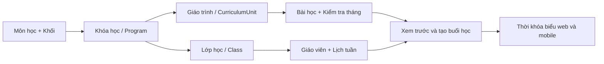

# Đề xuất UI và luồng Môn học – Khóa học – Giáo trình – Lớp học

Ngày lập: **07/10/2026**. Dùng để trao đổi với nhóm BE và làm cơ sở thiết kế lại FE web.

Tài liệu API đi kèm: [BACKEND_API_REQUIREMENTS_WEB_MOBILE.md](BACKEND_API_REQUIREMENTS_WEB_MOBILE.md). Danh sách route BE đã tìm thấy trong source: [BACKEND_API_EXISTING_ROUTES.md](BACKEND_API_EXISTING_ROUTES.md).

## 1. Phạm vi và giả định

Giữ ý tưởng trong sơ đồ: người thiết kế chuẩn bị giáo trình và bài cho từng buổi; quản lý chọn nội dung cho lớp; hệ thống ghép nội dung với lịch tuần để tạo thời khóa biểu.

- “Lớp 6” được hiểu là **khối 6**, gồm các lớp môn riêng như Toán 6A, Toán 6B, Lý 6A. Đây là giả định theo mô hình đang có trong ba repo, chưa phải xác nhận bổ sung của người dùng.
- Mỗi lớp thuộc **một khóa học/chương trình**. Nếu một lớp cố định học nhiều môn thì phải chốt lại mô hình, quan hệ giáo viên và lịch; không chỉ thay nhãn UI.
- Web phục vụ MANAGER, STAFF, TEACHER, CURRICULUM_DESIGNER. Mobile phục vụ PARENT, một tài khoản quản lý nhiều hồ sơ con; không có tài khoản học sinh riêng.
- Đây là **đề xuất**, chưa thay đổi màn hình, API hoặc database.

## 2. Thuật ngữ dùng chung

| Nhãn trên UI          | Thực thể/field hiện có                                   | Ý nghĩa                                                               | Ví dụ                  |
| --------------------- | -------------------------------------------------------- | --------------------------------------------------------------------- | ---------------------- |
| Môn học               | Hiện là Program.subject dạng chuỗi; chưa có bảng Subject | Danh mục môn dùng chung                                               | Toán                   |
| Khối                  | Program.grade, StudentProfile.grade                      | Khối học sinh, từ 6 đến 9                                             | Khối 6                 |
| Khóa học              | Program                                                  | Chương trình của một môn, một khối                                    | Toán 6 cơ bản          |
| Giáo trình / học phần | CurriculumUnit                                           | Một bộ nội dung có khoảng áp dụng, phiên bản và trạng thái duyệt      | Học kỳ I – v1          |
| Bài học               | Lesson, kind=LESSON                                      | Nội dung cho một buổi học thường, có thứ tự                           | Bài 1: Tập hợp         |
| Kiểm tra tháng        | Lesson, kind=MONTHLY_TEST, monthKey                      | Nội dung kiểm tra được xếp vào buổi cuối tháng                        | Kiểm tra tháng 11      |
| Lớp học               | Class                                                    | Nhóm học sinh học khóa đó, có giáo viên, sĩ số, học phí và lịch riêng | Toán 6A                |
| Lịch tuần             | WeeklySchedule                                           | Các khung giờ lặp lại của lớp                                         | Thứ 2, 4 · 18:00–20:00 |
| Buổi học              | ClassSession                                             | Bài/kiểm tra được xếp vào ngày, giờ cụ thể                            | 02/11/2026 · Bài 1     |

Khuyến nghị dùng **Khóa học** nhất quán trên UI; API tiếp tục dùng tên **Program/programId** để giữ tương thích. Nếu trung tâm chọn nhãn “Chương trình” thì dùng nhãn đó ở toàn bộ các màn.

Giáo trình có thể gồm nhiều học phần theo kỳ/tháng. Bài học được soạn một lần trong học phần và nhiều lớp có thể dùng chung phiên bản đã duyệt. Học phí và lịch tuần thuộc lớp.

## 3. Quan hệ và trình tự thao tác



Luồng nội dung: **Tạo/chọn môn → Tạo khóa học theo khối → Soạn giáo trình → Quản lý duyệt**.

Luồng vận hành: **Tạo lớp thuộc khóa học → Lưu lịch tuần → Chọn giáo trình đã duyệt → Xem trước → Tạo lịch học**.

Hai luồng có thể chuẩn bị song song. Lớp được lưu trước khi giáo trình sẵn sàng. Tạo lớp, mở đăng ký và tạo buổi học là các hành động riêng; lưu lịch tuần không có nghĩa các buổi học đã được sinh.

### Điểm cần BE chốt trước khi triển khai

BE hiện có CurriculumTrack theo môn + khối. ListUnits với programId và Plan sinh lịch kiểm tra theo track, chưa bắt buộc CurriculumUnit.programId bằng Class.programId. Unique của học phần cũng theo track, khoảng ngày và version.

**Đề xuất mặc định:** chọn giáo trình đúng programId của lớp. Hai khóa “Toán 6 cơ bản” và “Toán 6 nâng cao” có thể có nội dung khác nhau. Nếu muốn dùng chung giáo trình giữa nhiều khóa cùng track thì cần quan hệ áp dụng rõ ràng và UI hiển thị khóa được phép dùng; không suy ra khả năng áp dụng chỉ từ tên môn và khối. Xem yêu cầu CUR-02 trong tài liệu API.

BE hiện còn yêu cầu có ít nhất một lớp cùng track đã lưu lịch tuần mới cho duyệt học phần (NO_SCHEDULED_CLASS). Để hỗ trợ trình tự nội dung chuẩn bị trước lớp, đề xuất **duyệt chất lượng/cấu trúc nội dung độc lập**, rồi kiểm tra đủ bài/kiểm tra tháng theo lịch từng lớp ở preview/generate. Nếu giữ ràng buộc hiện tại, UI phải hướng dẫn tạo lớp và lịch tuần trước bước duyệt. Xem CUR-03.

## 4. Cấu trúc điều hướng

| Nhóm             | Màn hình                       | Vai trò chính                                                        |
| ---------------- | ------------------------------ | -------------------------------------------------------------------- |
| Đào tạo          | Môn học, Khóa học              | Quản lý thiết lập danh mục; designer đọc                             |
| Nội dung đào tạo | Giáo trình                     | Designer soạn; quản lý duyệt; giáo viên đọc nội dung được phân công  |
| Lớp học          | Danh sách, chi tiết, tạo lớp   | Quản lý cấu hình; nhân viên tra cứu; giáo viên xem lớp của mình      |
| Lịch học         | Lịch tuần/tháng, chi tiết buổi | Quản lý vận hành lịch lớp; nhân viên tra cứu; giáo viên xem lịch dạy |

Giữ cùng ngữ cảnh **Khối → Môn → Khóa học** ở bộ lọc, tiêu đề và breadcrumb. Điều hướng từ khóa học sang tạo giáo trình/tạo lớp phải điền sẵn khóa đã chọn. Phân quyền theo hành động, không dựa vào việc tên URL có chứa manager.

## 5. Các màn hình đề xuất

### 5.1 Môn học

- Danh sách: mã môn, tên môn, số khóa học, số lớp, đang sử dụng.
- Popup tạo/sửa: mã môn, tên môn. Sau khi lưu có hành động “Tạo khóa học cho môn này”.
- Môn đã có khóa học được ngừng sử dụng thay vì xóa làm mất liên kết.
- Khối 6–9 là tập giá trị cố định; chưa cần API CRUD khối nếu không có yêu cầu mở rộng.

**Khoảng thiếu:** BE đang lưu môn dưới dạng chuỗi trên Program, chưa có CRUD Subject. Nếu giữ môn dạng chuỗi thì UI chỉ có ô chọn/gợi ý tên; không trình bày đó là danh mục có CRUD thật.

### 5.2 Khóa học

Form: tên khóa, môn, khối; mô tả và bộ sách là các trường đề xuất bổ sung. Tổng số bài tính từ giáo trình thay vì nhập ở nhiều màn.

Trang chi tiết:

```text
Đào tạo / Khối 6 / Toán / Toán 6 cơ bản

Toán 6 cơ bản               [Tạo giáo trình] [Tạo lớp từ khóa học]
Toán · Khối 6

[Tổng quan] [Giáo trình] [Các lớp áp dụng]
```

Tab Giáo trình liệt kê tên học phần, khoảng áp dụng, phiên bản, số bài thường, số kiểm tra, Nháp/Đã duyệt. Tab Lớp hiển thị các lớp thuộc programId. Designer có nút tạo giáo trình; quản lý có nút tạo lớp và duyệt nội dung phù hợp.

### 5.3 Soạn giáo trình

Trang đầy đủ với ba bước: **Thông tin → Nội dung → Kiểm tra và hoàn tất**.

- Thông tin: khóa học, tên học phần, từ ngày, đến ngày. Môn và khối lấy từ khóa đã chọn.
- Nội dung: bảng thứ tự, tên bài, nội dung tóm tắt, loại bài, thao tác. Mở drawer để sửa nội dung dài; có thao tác thêm/xóa/sắp thứ tự trong bản nháp.
- Kiểm tra: số thứ tự liên tục, trường bắt buộc, kiểm tra tháng, lượng nội dung cần cho lịch của các lớp áp dụng.
- Toolbar: **Thêm bài · Nhập CSV · Tải CSV mẫu · AI gợi ý nội dung**.
- Nháp được sửa. Bản đã duyệt giữ nguyên; chỉnh sửa bằng phiên bản nháp mới.

Trạng thái đã có: DRAFT và APPROVED. Nhãn “Chờ duyệt” chỉ thêm khi BE có trạng thái/quy trình tương ứng; không tự biến DRAFT thành một trạng thái API mới.

### 5.4 Nhập CSV và AI

Luồng: **Chọn file → Đối chiếu cột → Xem trước/lỗi từng dòng → Sửa → Nhập vào bản nháp**.

Mẫu đề xuất:

```csv
kind,sequence,title,content,monthKey
LESSON,1,Tập hợp,Khái niệm và cách biểu diễn tập hợp,
LESSON,2,Số tự nhiên,Đọc viết và so sánh số tự nhiên,
MONTHLY_TEST,,Kiểm tra tháng 11,Kiểm tra các nội dung đã học,2026-11
```

- sequence bắt đầu từ 1, liên tục với bài thường; kiểm tra dùng monthKey.
- Thông tin khóa/học phần lấy từ màn hiện tại; mỗi dòng CSV không tự tạo môn/khóa/lớp mới.
- File UTF-8, hỗ trợ dấu tiếng Việt, nội dung nhiều dòng và dấu phẩy trong ô có quote.
- Preview chưa lưu bài. Commit lưu toàn bộ tập hợp hợp lệ, có bảo vệ nhập lặp và kiểm tra phiên bản nháp.
- AI gợi ý chủ đề, tên bài, nội dung và cách chia thành từng buổi dựa trên thông tin người thiết kế cung cấp. Kết quả là đề xuất để xem/sửa; chỉ người dùng chọn mới đưa vào nháp.
- AI gợi ý và CSV là API mới; không dùng endpoint upload ảnh bài nộp của PARENT cho file CSV của designer.

### 5.5 Tạo và cấu hình lớp

Wizard: **Thông tin lớp → Giáo trình → Lịch tuần → Xem trước**.

| Bước          | Nội dung                                                                   | Kết quả                               |
| ------------- | -------------------------------------------------------------------------- | ------------------------------------- |
| Thông tin lớp | Khóa học, tên lớp, giáo viên, sức chứa, học phí tháng; phòng nếu BE hỗ trợ | Class, mặc định chưa mở đăng ký       |
| Giáo trình    | Chọn bản đã duyệt, hiển thị phiên bản và khoảng áp dụng                    | Lựa chọn nội dung cho đợt tạo lịch    |
| Lịch tuần     | Thứ 1–7 theo ISO, giờ bắt đầu/kết thúc; khoảng ngày cần tạo buổi           | WeeklySchedule và phạm vi sinh lịch   |
| Xem trước     | Ngày, giờ, bài/kiểm tra, giáo viên; thiếu nội dung hoặc xung đột           | Preview; sau đó xác nhận tạo buổi học |

Nút **Lưu lớp** cho phép dừng để hoàn thiện sau. Nút **Tạo lịch học** chỉ bật khi preview khớp lựa chọn hiện tại và không có xung đột. Giáo viên chọn bằng tên/email, lưu teacherId; không nhập mã tài khoản thủ công.

Giữ nguyên điều kiện hiện có: cần lịch tuần trước khi mở đăng ký; cần giáo viên ACTIVE trước khi sinh lịch. Không tự thêm điều kiện “đã sinh lịch mới được mở đăng ký” khi chưa chốt nghiệp vụ.

Việc “gắn khóa học vào lớp” tương ứng chọn programId lúc tạo lớp. Việc “gắn giáo trình” tương ứng chọn CurriculumUnit cho đợt lịch; hai hành động khác nhau. Đổi khóa của lớp đã có dữ liệu cần quy trình riêng vì API sửa lớp hiện không nhận programId.

### 5.6 Chi tiết lớp và thời khóa biểu

```text
Toán 6A                                  [Mở/Đóng đăng ký]
Khóa học: Toán 6 cơ bản
Giáo trình: Học kỳ I · v1 · Đã duyệt
Lịch tuần: Thứ 2, 4 · 18:00–20:00

[Tổng quan] [Giáo trình] [Lịch học] [Học sinh]

                                    [Xem trước và tạo lịch]
```

- Hiển thị các học phần/phiên bản đã áp dụng theo từng khoảng ngày, tránh ghi một “giáo trình hiện tại” duy nhất cho lớp đã dùng nhiều học phần.
- Tách trạng thái đăng ký của lớp với mức hoàn thiện cấu hình: chưa có giáo viên, chưa có lịch tuần, chưa có giáo trình phù hợp, đã có buổi học. Các nhãn này có thể tính từ dữ liệu thật.
- Calendar web và mobile đọc cùng ClassSession; click buổi mở đúng bài, giáo viên và trạng thái.
- Lịch của con gồm lớp theo placement có hiệu lực, buổi học bù ở lớp khác, bảo lưu và buổi bị hủy. Các thay đổi không làm mất lịch sử.

## 6. Phân vai cho luồng chung

| Hành động                                                  | Quản lý                 | Designer             | Nhân viên            | Giáo viên                        | Phụ huynh                       |
| ---------------------------------------------------------- | ----------------------- | -------------------- | -------------------- | -------------------------------- | ------------------------------- |
| Thiết lập danh mục, tạo lớp/lịch tuần, phân công giáo viên | Ghi                     | Đọc phục vụ soạn bài | Đọc phục vụ vận hành | Đọc lớp được phân công           | Đọc lớp con đã ghi danh         |
| Soạn CSV/bài/kiểm tra, tạo revision                        | Đọc/duyệt               | Ghi nháp của mình    | —                    | Đọc nội dung được phân công      | Đọc lộ trình được phép          |
| Duyệt giáo trình và tạo lịch                               | Ghi                     | Đọc kết quả          | Đọc                  | Đọc                              | Đọc lịch của con                |
| Ghi danh, thu đủ học phí                                   | Đọc tổng hợp theo quyền | —                    | Ghi                  | —                                | Xem bill/biên lai của con       |
| Học bù, chuyển lớp, bảo lưu, kết thúc học                  | Đọc theo quyền          | —                    | Ghi                  | Đọc kết quả                      | Đọc kết quả của con             |
| Điểm danh, giao bài, chấm và công bố                       | Đọc vận hành khi cần    | —                    | Đọc phục vụ vận hành | Ghi trong phạm vi được phân công | Nộp bài, xem kết quả đã công bố |

Đây là quyền đích theo SRS; các chênh lệch với service BE/BFF hiện tại được ghi ở tài liệu API, không xem bảng này là quyền đã triển khai.

## 7. Tiêu chí nghiệm thu UI – BE

1. Tạo khóa “Toán 6 cơ bản”, mở tạo giáo trình/tạo lớp từ khóa này: programId được giữ đúng, môn/khối không yêu cầu nhập lại.
2. Nhập CSV hợp lệ: đúng thứ tự và đúng một kiểm tra cho mỗi tháng yêu cầu; file lỗi chỉ hiện preview lỗi, không lưu một phần.
3. Nháp sửa được, APPROVED khóa sửa; revision mới không thay nội dung các buổi đã sinh.
4. Hai khóa cùng môn/khối nhưng khác nội dung không dùng lẫn học phần khi chưa được khai báo dùng chung.
5. Hai lớp thuộc cùng khóa có lịch tuần khác nhau dùng chung giáo trình, tạo ngày học theo lịch từng lớp.
6. Xung đột giáo viên/lớp/phòng nếu có, thiếu bài hoặc thiếu kiểm tra trả lỗi cụ thể trước khi tạo lịch.
7. Retry tạo lịch dùng cùng key/body, không có hai bộ buổi học. Chia khoảng sinh lịch thành nhiều đợt vẫn giữ đúng thứ tự bài.
8. Sau khi STAFF thu tiền, con xuất hiện trong roster đúng kỳ và phụ huynh thấy ghi danh/bill/biên lai; không thêm bước claim link.
9. Giáo viên thấy lịch của mình, điểm danh đúng con; phụ huynh thấy kết quả đã chốt, lịch học bù và lịch sử sau kết thúc học.

## 8. Source làm cơ sở

- FE web: src/features/registration-flow/components/programs-view.tsx, class-editor.tsx; src/features/curriculum/components và api.ts; src/types/backend.ts, curriculum.ts; src/constants/role-access.ts.
- FEM: src/api/endpoints.ts, wired-routes.ts; src/features/parent-dashboard/api/parent-dashboard-api.ts, parent-data-mappers.ts; src/features/parent-dashboard/types.ts; docs/SRS.md.
- BE: src/modules/registration-flow; src/modules/curriculum-scheduling; prisma/schema.prisma.

Tài liệu phản ánh source đang có tại workspace, gồm thay đổi chưa commit. Chưa chạy nghiệm thu API trực tiếp trong lần lập tài liệu này.
